<h1 align="left" id="caio-title">Hi, I'm Caio!</h1>
<h3 align="left">Software Engineer · DevOps </h3>

  
  
  

<table width="100%">
  <tr>
    <td valign="middle" width="60%">

-  &nbsp;B.S. in **Computer Science** at **[UFRN](https://www.metropoledigital.ufrn.br/)** — Natal, RN, Brazil
-  &nbsp;**DevOps & Software Engineer** at [Metrópole Digital / UFRN](https://www.metropoledigital.ufrn.br/)
-  &nbsp;Connect with me on **[LinkedIn](https://www.linkedin.com/in/caio-daniel)**
-  &nbsp;Reach me at **caiodanielfonseca@gmail.com**

</td>
    <td valign="top" width="40%" align="center">
      
    </td>
  </tr>
</table>

<h2 align="left" id="caio-tech">Current Working Tech Stack</h2>

  

<h2 align="left">
  Stats
</h2>

  
  
  

